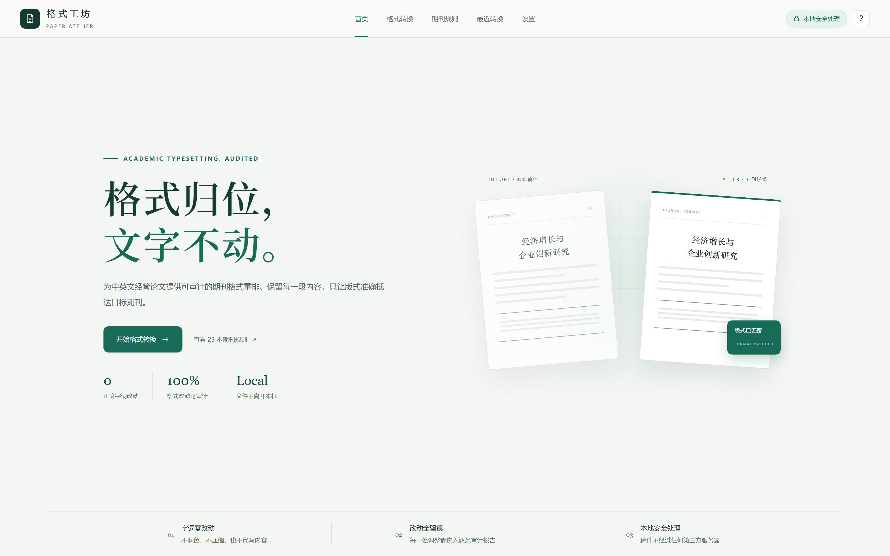
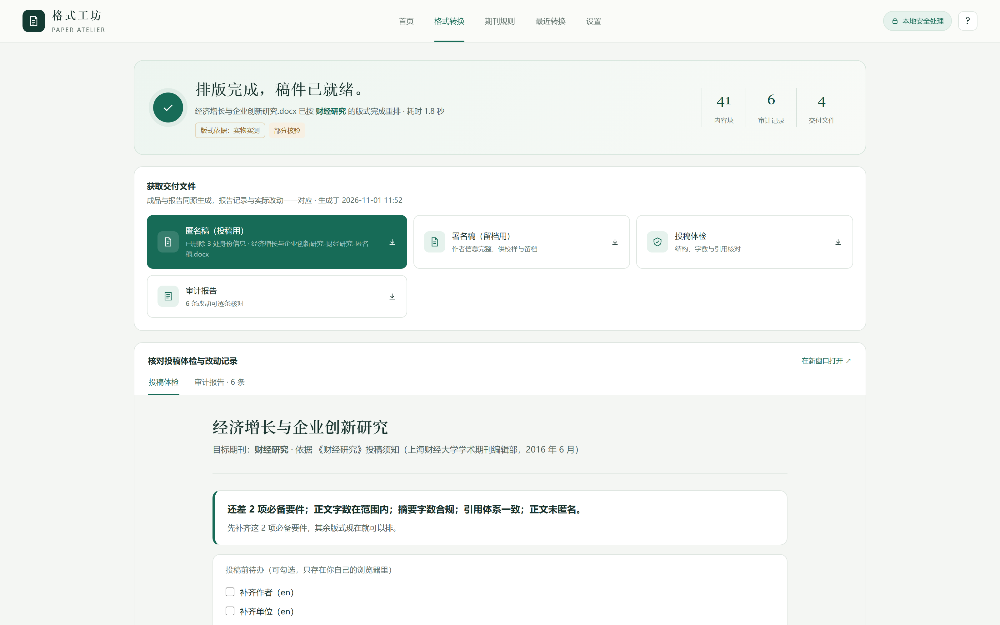
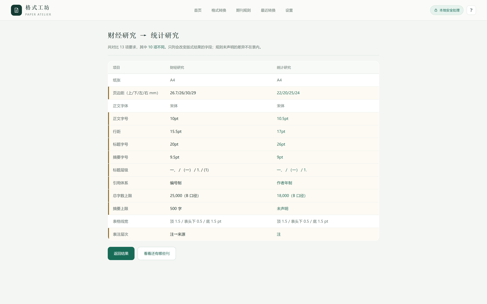
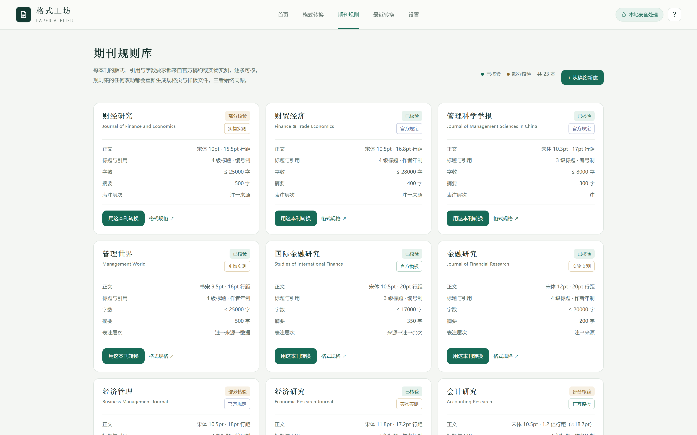
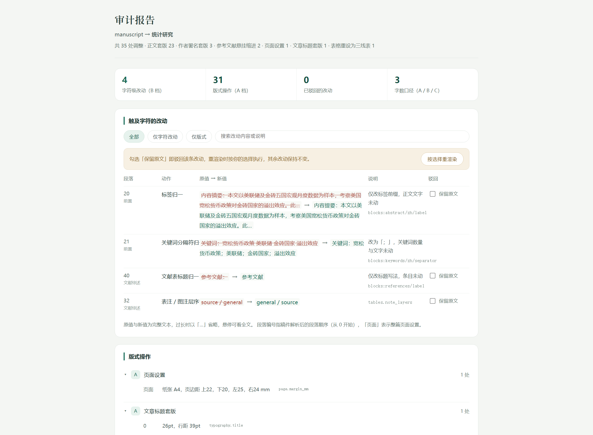

# 格式工坊 · Paper Format Workshop

[](https://github.com/Sky-scrape/format-workshop/actions/workflows/tests.yml)
[](LICENSE)

> 把一篇已成稿的经管论文（中英文皆可），**无损重排**到目标期刊的格式要求上，并出具**可审计**的合规报告。

一个跑在本机的工具。上传 `.docx`，选一本期刊，拿到三样东西：格式正确的成品、一份逐条可核的审计报告、一份带修订标记的对照版。

**稿子不出本机。** 查重和在线排版类服务都要你把全文传上去，这个不用——它就是个本地 Web 应用，`127.0.0.1:5000`，不联网也能跑（AI 辅助是可选开关，默认关闭）。



---

## 一次转换，四份交付

匿名稿（投稿用）、署名稿（留存用）、投稿体检、审计报告。四份同源，报告与实改一一对应。

41 个内容块、6 条审计记录——每一条都能点开看原值和新值。



换一本刊，规则差异逐项列出。下面这次对比的 13 项里有 10 项不同，差异行标黄：



规则库每本都标可信度：**官方明文** 还是 **已发表论文实测**。C 档提醒也会说清楚"须知里没写"，不替期刊猜：



> 截图取自合成测试稿，未使用任何真实论文。生成脚本见 `.workbuddy/shots.py`（本地工具，不入库）。

---

## 它不做什么

这三条是硬边界，不是免责声明：

1. **不改写任何文字、句子与措辞**
2. **不增删任何内容**——段落、图表、脚注、参考文献条目，一条都不动
3. **不为满足字数要求做任何压缩或扩写**，连"仅供参考的简化版"也不生成

市面上大多数"论文助手"卖的是改写，这个卖的是**不改**。投稿前最怕的不是格式没调好，是工具顺手把你的论证改了。

---

## 为什么敢说"不改你的字"

靠的不是承诺，是代码里的四道闸门。

### 四档变更权限

| 档位 | 含义 | 典型操作 | 交互 |
|---|---|---|---|
| **A 自动执行** | 纯版式，不触及任何字符 | 字体字号、行距、页边距、分栏、标题层级、三线表边框、图表注位置、页眉页脚 | 直接应用，进报告 |
| **B 需确认** | 触及字符，不触及字词 | 参考文献条目格式、全半角、标点规范、脚注位置与编号 | 逐条确认或按类批量确认 |
| **C 仅报告** | 只判断，不修改 | 总字数超限、摘要超限、图表数量超限、必备声明缺失 | 只出现在报告里 |
| **D 禁止** | 当前策略下不可执行 | 改写句子、删减段落、生成新版摘要、拆分合并句子 | 拒绝，并说明原因 |

### 字符级白名单

格式规范化本身会改变字符数（全角转半角、删多余空格）。所以判定的单位不是字符，是**字词**：

- 字词层面：零改动
- 字符层面：只走白名单（N-01 ~ N-08），其余一律不动
- 每一次改动：进审计报告，可逐条驳回

### 审计报告

每处改动一条记录，字段固定：

```
位置    节号 / 段序号 / 字符偏移
动作    标签归一 / 正文套版 / 标题重新编号 …
原值    改动前片段          新值    改动后片段
说明    改成了什么          来源    自动执行 / 已驳回
依据    规则集里的具体字段，如 typography.body.size_pt
```

**「依据」不是一句空话**——它指过去必须真能落到规则集里的一个值。`tools/rules_ref.py` 负责解析，指不到就报错，测试里逐条验。报告页上每条改动下面都印着这个引用，你可以自己去规则集里翻。

正文套版（A 档，只改版式）同样逐条记录：哪一段、原来什么行距、改成了什么。原先这里是个空白——标签、编号这些小事都记了，最显眼的正文重排反倒一条没有。



上半部分是触及字符的改动（B 档，逐条列原值→新值，可勾选保留原文），下半部分按动作分组的版式操作（A 档）。每条下面的灰色小字就是它在规则集里的依据。

底部还有一节**本刊的推定项**：凡是稿约和样张里都找不到依据、只能按同类惯例推的值（比如某刊三篇样本都没有副标题，副标题字号只能照主标题推），报告会明说是推定，不会混在「期刊要求」里蒙混过去。

**无报告视为交付失败**，即使正文完全正确。报告支持按类别筛选、整体导出、逐条驳回后重渲染。

### 未过校验的输出不交付

模型可以生成任何东西，但差异里只要出现非白名单项，任务直接失败并阻断输出。校验在代码里，不在提示词里。

---

## 字数：三个口径一起给

同一个 Word 文件，"字数"能差 15% 以上：

| 口径 | 定义 | 对应 Word |
|---|---|---|
| A | 字符数（不计空格） | 字符数(不计空格) |
| B | 中文字符数 + 英文单词数 | 中文字数 |
| C | 字符数（计空格） | 字符数(计空格) |

只报一种必然误判。报告里三个都给，并注明该期刊实际采用哪种；查不到就标"待确认"，不猜。

---

## 一本期刊，三件产物

| 产物 | 读者 | 作用 |
|---|---|---|
| `{id}.json` | 机器 | 唯一真源，渲染与校验的唯一输入 |
| `{id}.sample.docx` | 人 | 版式样板，打开 Word 三十秒核对完 |
| `{id}.spec.html` | 人 | 规格页，逐条列出要求 + 成品预览 |

样板和规格页**禁止手写**，只能由规则集渲染生成。手写的样板必然与实现漂移，而漂移的样板比没有样板更糟——它会让你照着错误的样子核对。

重建统一走一条命令：

```bash
python tools/build_journal.py rules/journal/{id}.json
```

---

## 快速开始

需要 Python 3.10+。

```bash
pip install -r requirements.txt
python app.py
```

浏览器会自动打开 `http://127.0.0.1:5000`。常用参数：

```bash
python app.py --port 5001      # 换端口
python app.py --no-browser     # 不自动开浏览器
```

Windows 下也可直接双击根目录的 `格式工坊.bat`（静默后台启动，双击第二次是打开页面）。

### 可选依赖

| 依赖 | 缺了会怎样 | 装法 |
|---|---|---|
| LibreOffice | 规格页里没有成品 PDF 预览，其余功能正常 | 装完 `soffice` 在 PATH 即可 |
| RapidOCR | 扫描版稿约 PDF 无法取字；文字层 PDF 不受影响 | `pip install rapidocr-onnxruntime` |
| 任意 OpenAI 兼容接口 | AI 辅助关闭，纯规则引擎照常工作 | 页面「设置」里填，默认 DeepSeek |

AI 在这套系统里**只标注、不落笔**：它只负责指出"这里可能有问题"，改动一律由规则引擎执行。所以不配 API 也能完整跑完全流程。

---

## 目录结构

```
app.py                    Flask 入口，路由与流水线编排
DESIGN.md                 产品设计约束（改动前先读这个）
tools/
  parse_docx.py           docx → 中间表示（IR）
  apply_details.py        个人信息与缺失要件注入
  render_from_ir.py       IR → 成品 docx
  compliance_report.py    合规报告生成
  render_audit.py         审计报告与差异渲染
  ai_assist.py            AI 辅助（可选，只标注）
  ocr.py                  PDF 取文：文字层优先，缺则 OCR
  extract_journal.py      稿约 PDF → 规则集草稿
  build_journal.py        规则集 → 样板 + PDF + 规格页
  analyze_manuscript.py   稿件体检
  anonymize.py            匿名化处理
templates/                页面模板
rules/
  journal-schema.md       规则集字段规范
  journal/                期刊规则集（见下节）
  examples/               规则集样例
config/
  ai.example.json         AI 配置模板
docs/screenshots/         README 截图（由合成测试稿生成，不含真实论文）
tests/                    四条承诺的自动化验证（见「测试」一节）
```

---

## 测试

四条对外承诺，每条都有对应的用例守着——因为它们全都是**坏了也看不出来**的性质：

```bash
pip install -r requirements-dev.txt
pytest
```

| 文件 | 守的承诺 |
|---|---|
| `test_text_fingerprint.py` | 正文字词零改动：抹掉白名单归一后，改前改后逐字相同 |
| `test_audit_traceable.py` | 每处文字改动都有审计条目，依据能解析回规则集 |
| `test_idempotent.py` | 同一输入两次渲染结果相同；驳回一条只回退那一条 |
| `test_ruleset_is_source.py` | 渲染器里没有硬编码格式值；改规则集，成品跟着变 |
| `test_figure_safety.py` | 图片段不会被设成固定行距（那会把图裁成一条） |
| `test_equation_safety.py` | 公式对象不会被删，公式段不会被固定行距裁掉 |
| `test_footnote.py` | 脚注字体字号跟着规则集走；本来就合规的不虚报改动 |
| `test_citation.py` | 文献编号按目标刊改写法，前缀之外一字不动 |
| `test_limits.py` | 字数/关键词/标题上限按规则集检查；摘要四种写法都认 |
| `test_manuscript_matrix.py` | 换刊矩阵 + 一份「乱排」稿件，四条不变式逐项复核 |

测试用的是**合成稿**：由 `tools/render_sample.py` 从规则集渲染，正文是核验文本；另有一份手工构造的「乱排稿」（半角标点、制表符撑开的表题、错序表注、带固定行距的图片、手写编号的各级标题）。不依赖任何真实论文，因此可以在 CI 里跑，也可以公开。

线上状态：[](https://github.com/Sky-scrape/format-workshop/actions/workflows/tests.yml)

三处曾经是空白，现在补上了：审计条目带**机器可读的规则引用**（`typography.body.size_pt` 这种，可解析回规则集）、**正文套版**逐条进报告、**推定项**在报告里自报家门。每一条都有用例守着，防止回退。

---

## 期刊规则库与开源边界

规则库是这个项目真正的重资产：每本期刊要读投稿须知、下载版式样张、逐条比对、写进 JSON、再渲染核对。截至 2026-11 已落地 **23 本**（中文 17 本 + 英文 6 本）。

本仓库**只收录 3 本示例**，够你验证完整流程：

| ID | 期刊 | 类型 |
|---|---|---|
| `cjyj` | 财经研究 | 中文 |
| `tjyj` | 统计研究 | 中文 |
| `gjjryj` | 国际金融研究 | 中文 |

3 本示例都是中文刊。英文规则集（China Economic Review、Journal of Development Economics、Economic Modelling 等 6 本）在完整库中，走同一套 schema——语言差异由 `scheme`、`lang`、`placement` 属性表达，代码里没有 `if language == 'zh'` 这种分支。

完整的 23 本规则集、以及期刊改版后的规则更新，不随这个仓库分发。

### 为什么规则库不一起开源

引擎值得开源——它证明"我不会改你的字"这件事，靠的正是源码可读。规则库不一样：它是持续消耗人力的活，期刊一改投稿须知，规则就得跟着改。开源引擎、保留规则库，是让这个工具能长期维护下去的方式。

### 自己加一本期刊

完全可以。规范见 [`rules/journal-schema.md`](rules/journal-schema.md)，大致流程：

1. 拿到该刊的官方投稿须知（PDF 或网页）与 2–3 篇已发表论文
2. `python tools/extract_journal.py 稿约.pdf` 生成规则集草稿
3. 人工核对着须知与样张逐条修订草稿（**这步不能省**，自动提取一定有错）
4. `python tools/build_journal.py rules/journal/{id}.json` 生成样板与规格页
5. 打开样板，逐项与该刊真实论文比对
6. 提交：JSON + 样板 + 规格页，一次提交三件

规则集里每一条都要能标出来源——是官方明确写的，还是从已发表论文版式反推的。反推的在报告里会标注置信度，这点不做含糊。

---

## 已知限制

- **英文刊的验证样本少于中文**。6 本英文规则集目前样本偏少，排版引擎对西文断词、悬挂缩进、图表注层次的处理不如中文稳。
- **版式类规则多为"已发表论文实测"**，不是期刊官方明文规定。报告里会区分这两类来源，前者标 `typography_source: published_layout`。
- **只处理 .docx**。`.doc` 请先用 Word 或 LibreOffice 另存。
- **不做公式重排**。Word 公式对象（OMML）原样保留，不改内部结构；但公式段落和图片段落一样，行距用「最小值」而不是「固定值」——固定值会把分式和上下标裁掉。
- **参考文献只改编号写法**。`[1]` / `〔1〕` / `［1］` / `1．` 这类前缀按目标刊统一（属 N-07 允许的标点规范化，逐条可驳回），条目里的作者、年份、类型标识、标点一律不动——那属于改写内容，本产品不做。著录格式不合规的条目，需要你自己改。
- **脚注只调字体字号**。脚注正文按规则集改成目标刊要求的字号与字体（并进审计），但**编号连续性与"页脚／文末"的位置切换不做**——稿件把脚注排在文末而目标刊要求页脚时，这一步得你自己挪。
- 扫描件稿约依赖 OCR，错字会影响规则提取质量，必须人工复核。

---

## 参与贡献

欢迎 PR，但有两条红线：

1. **不得引入任何改写文本的功能**。哪怕做成开关、哪怕默认关闭。一旦存在，这个工具的性质就变了。
2. **不得在规则集里写"推定"却不标注来源**。查不到就写 `null` 并在报告里标"待确认"，不许编。

规则集贡献、排版引擎修复、文档改进都欢迎。提交前请确认 `python app.py` 能在你的机器上跑起来，且改的是 `DESIGN.md` 里已有的约定——如果设计确实要变，先改设计文档再改代码。

---

## 许可证

[AGPL-3.0](LICENSE)。

选 AGPL 而不是 MIT，是因为它要求网络服务也必须开源：你可以拿去做自己的排版工具，但不能拿它做个闭源 SaaS 卖钱，再把这些约束偷偷删掉。这个项目的价值全在"可信"，而可信不能允许有人私下拆掉闸门。

---

## 免责声明

本工具只做版式重排，不对投稿结果、期刊审稿意见、学术规范问题承担任何责任。规则集可能与期刊最新要求存在时间差——投稿前请以期刊官网现行投稿须知为最终依据。

自己的稿子，自己最后看一眼。
